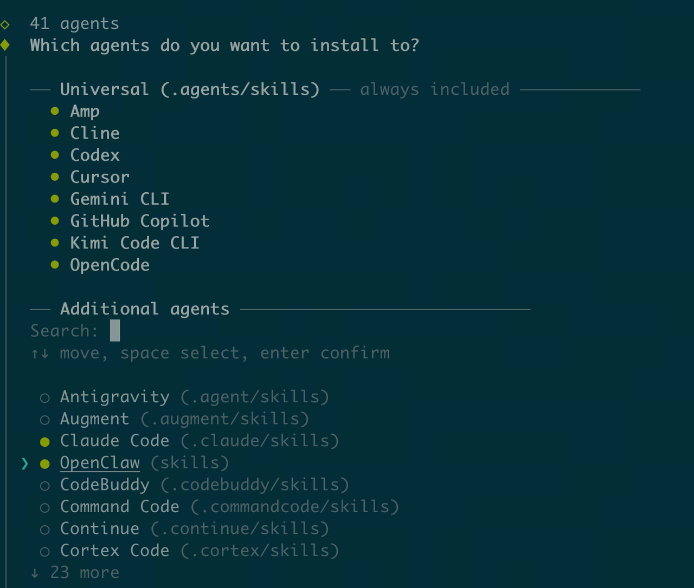
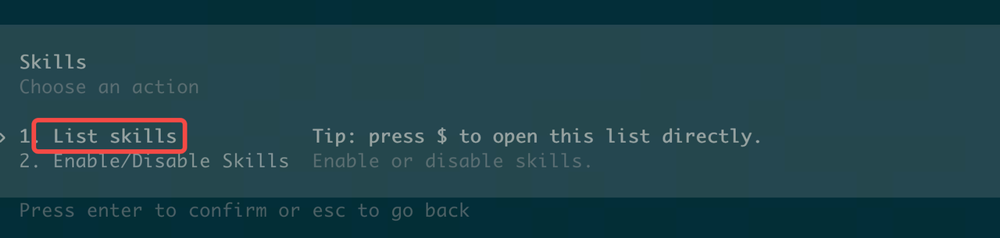
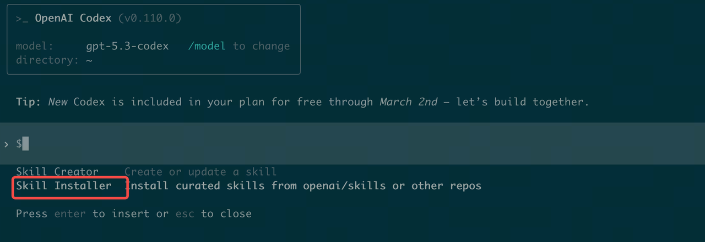
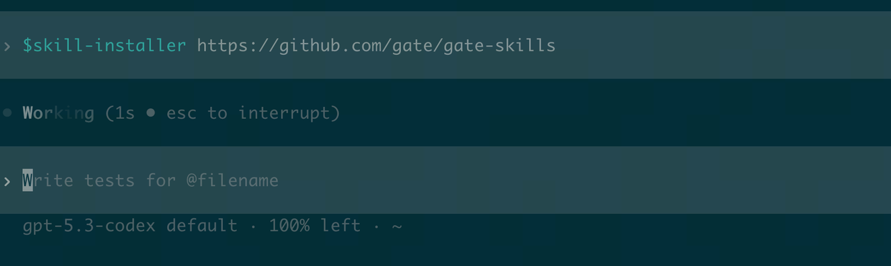
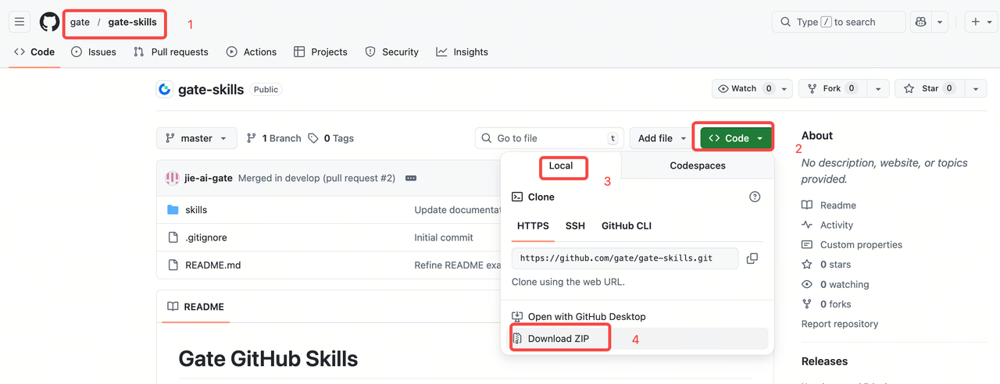
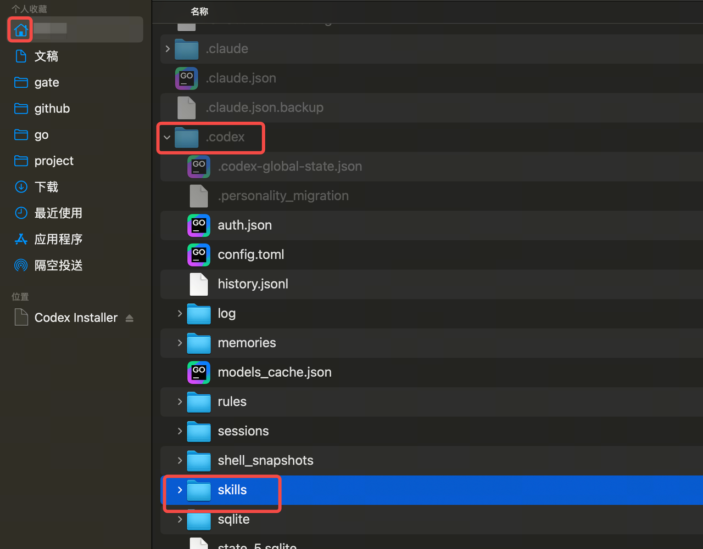

# Gate Skills

[English](README.md) | [中文](README_zh.md)

Gate Skills is an open skills marketplace that empowers AI agents with native access to Gate cryptocurrency ecosystem. From market analysis and derivatives monitoring to one-click MCP setup — all through natural language.

Built by Gate. Built for the crypto community.

## Gate CEX Skill 2.0

The six CEX source skills are [trade](skills/gate-cex-trade/SKILL.md), [earn](skills/gate-cex-earn/SKILL.md), [assets](skills/gate-cex-assets/SKILL.md), [subaccount](skills/gate-cex-subaccount/SKILL.md), [affiliate](skills/gate-cex-affiliate/SKILL.md) and [bot](skills/gate-cex-bot/SKILL.md). Alpha is included in trade. The six profiles document 379 unique owned command paths within the approved authoring scope (trade 282, earn 32, assets 29, subaccount 12, affiliate 12, bot 12). Trade also reuses one asset-owned read-only command, which is not counted twice. Use the official [Gate CLI](https://github.com/gate/gate-cli) and verify each required capability in the installed public release; the catalog is not a release guarantee. Their single shared source is `skills/_shared/cex/`.

Private reads and all writes use Gate CLI. Trade also permits the approved bounded public [GET compatibility reads](skills/gate-cex-trade/references/markets.md) and [WS helper](skills/gate-cex-trade/references/streams.md); these exceptions do not authorize private HTTP, MCP fallback, arbitrary endpoints or environment changes.

Build standalone packages before installation. Copy an entire generated skill directory to the host's skill directory; install only the requested packages. Do not install these source directories directly: their source links use the shared directory. The builder explicitly includes only the six CEX business packages.

Use an activated Python 3.11+ virtual environment for authoring tools. From the repository root:

```bash
# Install the pinned authoring dependencies in that environment.
python -m pip install -r scripts/requirements-cex.txt
# These isolated regressions build/check packages; they make no business API calls.
python -B -m unittest discover -s tests/cex -p 'test_*.py'
# Choose a new output directory; existing output is never overwritten.
python scripts/cex_skills.py build --source . --contract tests/cex/cli-contract.json --output dist/gate-cex-2.0
# Check one independently installed package against the approved CLI contract.
python scripts/cex_skills.py check --target dist/gate-cex-2.0/gate-cex-trade --package --contract tests/cex/cli-contract.json
```

Use [gate-cex-skill-audit](gate-cex-skill-audit/SKILL.md) for the nine-dimension review; the deterministic tool above covers structure, links and registered CLI contracts, not financial correctness or legal certification. Real transactions are never part of the default checks.

### Installation by product

| Product | Required installation |
|---------|-----------------------|
| Six CEX skills | Install [Gate CLI](skills/gate-cli-installer/SKILL.md), then copy only the requested generated standalone packages using the build instructions above. |
| Legacy Gate Pay | Retain the Exchange connection modes in [gate-mcp-installer](skills/gate-mcp-installer/SKILL.md); follow the payment skill's declared authorization. |
| Gate Pay x402 | Select [gatepay-local and optional merchant discovery](skills/gate-mcp-installer/README.md); configure the wallet and payment consent using [gate-pay-x402](skills/gate-pay-x402/SKILL.md). These MCPs are opt-in. |
| DEX / Info / News | Follow the selected product's CLI or MCP prerequisites. The MCP installer preserves Exchange modes for Pay but excludes CEX business skill directories from its source-copy step. |

Select the product and required skills first. The CLI installer installs the CLI binary; it does not install MCP servers. Keep existing user installations unless their removal is separately requested.

### Framework Compatibility

Use a host that can load the selected SKILL.md and its references, provide its declared CLI/MCP tools, and enforce the required permissions. Setup and reload steps depend on the host.

---

## Skills Overview

Versions below are Skill metadata, not CLI releases or proof of live service availability. Start Info/News requests with the CLI-primary entries; compatibility entries keep their own prerequisites and fallback rules.

| Skill | Description | Version | Entry / installation |
|-------|-------------|---------|----------------------|
| [gate-cex-trade](skills/gate-cex-trade/SKILL.md) | Trading and market/account trading context | `0.1.2` | Standalone packages |
| [gate-cex-earn](skills/gate-cex-earn/SKILL.md) | Earn products and collateral loans | — | Standalone packages |
| [gate-cex-assets](skills/gate-cex-assets/SKILL.md) | Balances, transfers, deposits and withdrawals | — | Standalone packages |
| [gate-cex-subaccount](skills/gate-cex-subaccount/SKILL.md) | Subaccount and API-key administration | — | Standalone packages |
| [gate-cex-affiliate](skills/gate-cex-affiliate/SKILL.md) | Relationships, commissions and statistics | — | Standalone packages |
| [gate-cex-bot](skills/gate-cex-bot/SKILL.md) | Grid, martingale and portfolio bots | — | Standalone packages |
| [gate-info-coinanalysis](#-gate-info-coinanalysis) | Single-coin comprehensive analysis: fundamentals, technicals, news, sentiment | `2026.4.6-1` | Compatibility entry |
| [gate-info-addresstracker](#-gate-info-addresstracker) | On-chain address tracking: profile, transaction history, fund flow analysis | `2026.4.3-1` | Compatibility entry |
| [gate-info-coincompare](#-gate-info-coincompare) | Multi-coin comparison with multi-dimensional analysis table | `2026.4.6-1` | Compatibility entry |
| [gate-info-defianalysis](#-gate-info-defianalysis) | DeFi ecosystem: TVL rankings, protocol metrics, yield/APY, stablecoins, bridges, exchange reserves, liquidation heatmaps (Gate-Info; read-only) | `2026.4.7-1` | Compatibility entry |
| [gate-info-macroimpact](#-gate-info-macroimpact) | Macro ↔ crypto: economic calendar, indicators, related news, and market snapshot linkage (Gate-Info + Gate-News; read-only) | `2026.4.6-1` | Compatibility entry |
| [gate-info-marketoverview](#-gate-info-marketoverview) | Crypto market overview: sector rankings, DeFi, events, macro summary | `2026.4.6-1` | Compatibility entry |
| [gate-info-riskcheck](#-gate-info-riskcheck) | Token & contract risk assessment: honeypot, rug pull, tax, holder concentration | `2026.4.3-1` | Compatibility entry |
| [gate-info-tokenonchain](#-gate-info-tokenonchain) | Token on-chain: holder distribution, activity, large transfers (Smart Money not in this version; Gate-Info; read-only) | `2026.4.7-1` | Compatibility entry |
| [gate-info-trendanalysis](#-gate-info-trendanalysis) | Trend & technical analysis: K-line, RSI, MACD, multi-timeframe signals | `2026.4.3-1` | Compatibility entry |
| [gate-news-briefing](#-gate-news-briefing) | Crypto news briefing: major events, trending news, social sentiment | `2026.4.7-1` | Compatibility entry |
| [gate-news-communityscan](#-gate-news-communityscan) | Community / X sentiment: discussion scan + quantitative social sentiment (UGC beyond X when available; Gate-News; read-only) | `2026.4.7-1` | Compatibility entry |
| [gate-news-eventexplain](#-gate-news-eventexplain) | Event attribution & explanation: why did X crash/pump, impact chain analysis | `2026.4.3-1` | Compatibility entry |
| [gate-news-listing](#-gate-news-listing) | Exchange listing/delisting tracker with fundamental supplements | `2026.4.6-1` | Compatibility entry |
| [gate-dex-market](#-gate-dex-market) | Gate DEX market data via OpenAPI: token info, K-line, rankings, security audit | `2026.4.8-1` | ✅ Active |
| [gate-dex-trade](#-gate-dex-trade) | Gate DEX trading: MCP + OpenAPI dual mode, smart routing for Swap execution | `2026.5.6-1` | ✅ Active |
| [gate-exchange-pay](#-gate-exchange-pay) | Gate Pay payment execution: complete merchant charges, pay-first flows, and output receipts | — | ✅ Active |
| [gate-mcp-installer](#-gate-mcp-installer) | One-click installer for Gate MCP servers and Skills for Cursor, Claude Code, Codex, and OpenClaw | `2026.11.2-1` | ✅ Active |
| [gate-dex-wallet](#-gate-dex-wallet) | Gate DEX comprehensive wallet: authentication, assets, transfers, DApp interactions | `2026.5.6-1` | ✅ Active |
| [gate-info-liveroomlocation](#-gate-info-liveroomlocation) | Gate live stream & replay listing: filter by tag, coin, sort order, and count | `2026.4.8-1` | ✅ Active |
| [gate-info-research](#-gate-info-research) | CLI-first market research and playbook routing | `2026.6.22-1` | CLI primary |
| [gate-cli-installer](skills/gate-cli-installer/SKILL.md) | Install the Gate CLI binary | `2026.11.2-1` | CLI installer |
| [gate-dex-market-cli](skills/gate-dex-market-cli/SKILL.md) | DEX market and token queries through gate-dex | `2026.5.7-1` | DEX CLI |
| [gate-dex-trade-cli](skills/gate-dex-trade-cli/SKILL.md) | DEX swap execution through gate-dex | `2026.5.7-1` | DEX CLI |
| [gate-dex-wallet-cli](skills/gate-dex-wallet-cli/SKILL.md) | DEX wallet, transfers and signing through gate-dex | `2026.5.7-1` | DEX CLI |
| [gate-info-risk](skills/gate-info-risk/SKILL.md) | CLI-first token, address and project risk checks | `2026.6.12-5` | CLI primary |
| [gate-info-web3](skills/gate-info-web3/SKILL.md) | CLI-first on-chain and Web3 queries | `2026.6.22-1` | CLI primary |
| [gate-news-intel](skills/gate-news-intel/SKILL.md) | CLI-first news, events and sentiment | `2026.6.22-1` | CLI primary |
| [gate-pay-x402](skills/gate-pay-x402/SKILL.md) | HTTP 402 payments, wallet setup and merchant discovery | `2026.4.10-1` | Optional Pay setup |

---

## 🎬 gate-info-liveroomlocation

> **Path**: `skills/gate-info-liveroomlocation/`

Gate live stream and replay listing. Filter by business type (Market Analysis, Hot Topics, Blockchain, Others), coin, sort order (hottest/newest), and count.

**Example Prompts**:
- `Show me the hottest live streams`
- `Find 5 SOL-related live rooms`
- `Latest market analysis replays`
- `Any live streams about BTC?`

---

## 📊 gate-dex-market

> **Path**: `skills/gate-dex-market/`

Gate DEX market data skill using OpenAPI mode with AK/SK authentication. Provides read-only queries for token info, K-line data, rankings, and security audits.

**Example Prompts**:
- `Get BTC token info`
- `Show me ETH K-line data`
- `What are the top trending tokens?`
- `Check security audit for this token`

---

## 🔄 gate-dex-trade

> **Path**: `skills/gate-dex-trade/`

Gate DEX trading comprehensive skill with MCP + OpenAPI dual mode support. Smart routing automatically selects the optimal trading method based on environment. Supports Swap execution across EVM and Solana.

**Example Prompts**:
- `Swap 100 USDT for ETH`
- `Exchange BNB for PEPE`
- `Get a quote for swapping SOL to USDC`
- `Buy some tokens using OpenAPI mode`

---

## 💼 gate-dex-wallet

> **Path**: `skills/gate-dex-wallet/`

Gate DEX comprehensive wallet skill. Unified entry point for authentication, asset queries, transfer execution, and DApp interactions. Routes to specific sub-modules based on user intent.

**Example Prompts**:
- `Log in to my wallet`
- `Check my wallet balance`
- `Transfer 0.1 ETH to 0x...`
- `Connect my wallet to Uniswap`
- `Sign this message`

---

## 🔍 gate-info-addresstracker

> **Path**: `skills/gate-info-addresstracker/`

On-chain address tracking and analysis. Fetches address profile, transaction history, and fund flow tracing. Supports basic queries and deep tracking modes across multiple chains.

**Example Prompts**:
- `Track this address 0x...`
- `Who owns this address?`
- `Show fund flow for bc1...`
- `Check address activity`

---

## 📊 gate-info-coinanalysis

> **Path**: `skills/gate-info-coinanalysis/`

Single-coin comprehensive analysis. Fetches fundamentals, market data, technicals, news, and social sentiment in parallel, then generates a structured analysis report.

**Example Prompts**:
- `Analyze ETH`
- `How is SOL doing?`
- `Is BTC worth buying right now?`
- `Give me a full analysis of DOGE`

---

## ⚖️ gate-info-coincompare

> **Path**: `skills/gate-info-coincompare/`

Multi-coin comparison (2–5 coins). Fetches market snapshots and fundamentals for each coin, then generates a multi-dimensional comparison table and summary.

**Example Prompts**:
- `Compare BTC vs ETH`
- `Which is better: SOL or AVAX?`
- `Compare BTC, ETH, SOL, and BNB`
- `What's the difference between DOGE and SHIB?`

---

## 🌐 gate-info-marketoverview

> **Path**: `skills/gate-info-marketoverview/`

Crypto market overview. Fetches global market data, sector rankings, DeFi overview, upcoming events, and macro summary in parallel, then generates a market briefing report.

**Example Prompts**:
- `How is the market today?`
- `Give me a market overview`
- `What's happening in crypto?`
- `Show me the overall market status`

---

## 🛡️ gate-info-riskcheck

> **Path**: `skills/gate-info-riskcheck/`

Token and contract risk assessment. Runs 30+ risk checks including honeypot detection, tax analysis, holder concentration, and naming risks. Generates a structured risk report.

**Example Prompts**:
- `Is this token safe? 0x...`
- `Check contract risk for PEPE`
- `Is this a honeypot?`
- `Could this be a rug pull?`

---

## 📉 gate-info-trendanalysis

> **Path**: `skills/gate-info-trendanalysis/`

Trend and technical analysis. Fetches K-line data, indicator history, multi-timeframe signals, and market snapshots in parallel. Generates a multi-dimensional technical analysis report.

**Example Prompts**:
- `Technical analysis for BTC`
- `Show me ETH RSI and MACD`
- `What's the trend for SOL?`
- `Check support and resistance levels for BNB`

---

## 🏗️ gate-info-defianalysis

> **Path**: `skills/gate-info-defianalysis/`

DeFi ecosystem analysis via Gate-Info MCP. Routes by intent to overview, single-protocol detail, yield pools, stablecoins, bridges, exchange reserves, or liquidation heatmaps; progressive loading where applicable. Read-only.

**Example Prompts**:
- `DeFi overview and top protocols by TVL`
- `Uniswap TVL and volume`
- `Best USDC lending APY`
- `Binance BTC reserves`
- `BTC liquidation heatmap`

---

## 🗓️ gate-info-macroimpact

> **Path**: `skills/gate-info-macroimpact/`

Macro-driven crypto analysis via Gate-Info and Gate-News MCP: economic calendar, macro indicator or summary, related news, and correlated coin market snapshot in parallel. Read-only.

**Example Prompts**:
- `How does CPI affect BTC?`
- `Any macro data today?`
- `Fed meeting impact on crypto`
- `Latest NFP and risk assets`

---

## ⛓️ gate-info-tokenonchain

> **Path**: `skills/gate-info-tokenonchain/`

Token-level on-chain analysis (holders, activity, large transfers) via Gate-Info MCP. Smart Money / `smart_money` scope not available in this version — use holders, activity, transfers only. Read-only.

**Example Prompts**:
- `ETH holder distribution`
- `On-chain activity for SOL`
- `Large transfers for BTC`
- `Full on-chain picture for ARB`

---

## 📰 gate-news-briefing

> **Path**: `skills/gate-news-briefing/`

Crypto news briefing. Fetches major events, trending news, and social sentiment in parallel, then generates a layered news briefing report.

**Example Prompts**:
- `What happened in crypto recently?`
- `Today's crypto highlights`
- `Any new updates in the market?`
- `Give me the latest crypto news`

---

## 🗣️ gate-news-communityscan

> **Path**: `skills/gate-news-communityscan/`

Community and social sentiment with **X/Twitter** as the primary surface via Gate-News MCP. Combines X discussion search and quantitative social sentiment. When multi-platform UGC is unavailable, label output **X/Twitter only**. Read-only.

**Example Prompts**:
- `What does the community think about ETH?`
- `Twitter sentiment on Bitcoin`
- `What are people saying about the ETF?`
- `KOL takes on SOL today`

---

## 💡 gate-news-eventexplain

> **Path**: `skills/gate-news-eventexplain/`

Event attribution and explanation. When users ask about price anomalies, traces event sources and combines market and on-chain data to generate an "Event → Impact Chain → Market Reaction" analysis report.

**Example Prompts**:
- `Why did BTC crash?`
- `What just happened to ETH?`
- `Why is SOL pumping?`
- `What caused the DOGE dump?`

---

## 📋 gate-news-listing

> **Path**: `skills/gate-news-listing/`

Exchange listing/delisting tracker. Fetches exchange announcements for new listings, delistings, and maintenance, then supplements high-interest new coins with fundamentals and market data.

**Example Prompts**:
- `Any new coins listed recently?`
- `What did Binance list this week?`
- `Show me recent delistings`
- `New token listings today`

---

## 🛠️ gate-mcp-installer

> **Path**: `skills/gate-mcp-installer/`

Unified installer for selected Gate MCP servers and non-CEX source skills. Supports Cursor, Claude Code, Codex, and OpenClaw/mcporter; CEX uses the standalone-package flow above.

**Quick Start**:
```bash
# From repo root
bash skills/gate-mcp-installer/scripts/install.sh
```

Optional: `--no-skills` to install MCP only; `--mcp main --mcp dex` etc. to install selected MCPs.

---

## 🔬 gate-info-research

> **Path**: `skills/gate-info-research/`

CLI-first research entry for structured market briefs, single-coin research, comparisons, trends and macro context. It routes risk-first, on-chain-first and news-first questions to the corresponding primary entries; follow its declared fallback rules.

**Example Prompts**:
- `Give me a market research brief`
- `Compare BTC and ETH fundamentals and risk`
- `Why is SOL pumping today?`
- `Daily brief on the crypto market`

---

## 💳 gate-exchange-pay

> **Path**: `skills/gate-exchange-pay/`

Gate Pay payment execution skill. Complete merchant charges, satisfy pay-first flows (e.g. HTTP 402), and output receipts via Gate Pay. Requires prior Gate payment authorization.

**Example Prompts**:
- `Pay with Gate Pay`
- `Complete payment for this order`
- `Pay for order using Gate Pay`

---

## Getting Started

### Prerequisites

- An AI agent environment that supports skill loading (e.g., Cursor, OpenClaw)
- Gate CLI for the six CEX skills; install their generated standalone packages as described above
- Node.js & npm only for workflows that use Node-based installers or MCP services

### Setup

For CEX, use the Gate CLI and standalone package instructions above. For Pay or other MCP-dependent products, use `gate-mcp-installer`; it auto-detects Cursor, Claude Code, Codex, or OpenClaw:

```bash
# From repo root
bash skills/gate-mcp-installer/scripts/install.sh
```

Or simply ask the AI assistant:
```
Help me install Gate MCP
```

MCP only: `bash skills/gate-mcp-installer/scripts/install.sh --no-skills`

After loading `gate-pay-x402`, configure its optional payment and merchant-discovery
services explicitly. The installer README lists the public HTTPS catalog URL:

```bash
# Configure only the two x402 services for Cursor; skip source-skill copying.
bash skills/gate-mcp-installer/scripts/install.sh --platform cursor --mcp gatepay-local --mcp gatepay-discovery --no-skills
```

Configure the wallet locally following [gate-pay-x402](skills/gate-pay-x402/SKILL.md).
The six CEX skills use their own CLI setup/authentication rules.

### Start Using Skills

After installation, ask your AI agent any market or trading question in natural language.

---

## Skills Installation Guide

Verify the selected skill names against their actual `SKILL.md` frontmatter. Do not use a historical screenshot or a fixed skill count as proof of installation. CEX installation uses generated standalone packages.

### General Skills Installation (non-CEX)

The source-copy and marketplace examples below apply to non-CEX skills. Install CEX from the generated packages described above; copying all source directories does not produce standalone CEX packages.

1. Check whether `npx` is already installed (if not, see the appendix):

   ```bash
   npx -v
   ```

   If a version number is returned (for example, `11.8.0`), `npx` is installed.

2. Install skills with interactive selection:

   ```bash
   npx skills add https://github.com/gate/gate-skills
   ```

3. Install a specific skill (example: `gate-info-coinanalysis`):

   ```bash
   npx skills add https://github.com/gate/gate-skills --skill gate-info-coinanalysis
   ```
   


### Install Skills in Claude CLI

#### Option 1: Natural Language Installation (Recommended)

```text
help me to install skills, github url is: https://github.com/gate/gate-skills
```

Verify that the selected skill is loaded under its actual name.

#### Option 2: Manual Installation

Step 1: Download the skills package (GitHub: <https://github.com/gate/gate-skills>)

Step 2: Unzip the package and copy it to `~/.claude/skills/`.

- Show hidden folders: open your user home folder, then press `Command + Shift + .` (press again to hide)
- Copy folders to target path: copy only the selected non-CEX `skills` subfolders from `gate-skills-master` into `~/.claude/skills/`
- Verify installation: run `/skills` in Claude CLI, and verify the selected names

### Install Skills in Codex CLI

#### Option 1: Natural Language Installation (Recommended)

```text
help me to install skills, github url is: https://github.com/gate/gate-skills
```

Changes take effect after restarting Codex.

#### Option 2: Terminal Installation

1. In terminal, type `/skills`, choose `1. List skills`, select `Skill Installer`, and enter `https://github.com/gate/gate-skills`

   
   
   

2. Verify installation: restart the terminal and run `/skills` -> `List Skills`

#### Option 3: Manual Installation

Step 1: Download the skills package (GitHub: <https://github.com/gate/gate-skills>)



Step 2: Unzip the package and copy it to `~/.codex/skills/`.

1. Show hidden folders: open your user home folder, then press `Command + Shift + .` (press again to hide)

   

2. Copy folders to target path: copy only the selected non-CEX `skills` subfolders from `gate-skills-master` into `~/.codex/skills/`

3. Verify installation: restart the terminal and run `/skills` -> `List Skills`

### Install Skills in OpenClaw

#### Option 1: Install via Chat (Recommended)

In the OpenClaw chat interface (such as Telegram or Feishu), send the GitHub URL directly to the assistant, for example:

```text
Help me install this skill: https://github.com/gate/gate-skills
```

The assistant will automatically pull the repository, configure the environment, and try to load the skill.

#### Option 2: Auto-install with ClawHub (Recommended)

- Official marketplace (requires `npx`; see appendix for installation):

  ```bash
  npx clawhub@latest install gate-skills
  ```

- GitHub repository:

  ```bash
  npx clawhub@latest add https://github.com/gate/gate-skills
  ```

#### Option 3: Manual Installation

Step 1: Download the skills package (GitHub: <https://github.com/gate/gate-skills>)


Step 2: Unzip the package and copy it to `~/.openclaw/skills/`.

1. Show hidden folders: open your user home folder, then press `Command + Shift + .` (press again to hide)
2. Copy folders to target path: copy only the selected non-CEX `skills` subfolders from `gate-skills-master` into `~/.openclaw/skills/`

Step 3: Restart OpenClaw Gateway.

### Appendix: Install npx on macOS

1. Check whether `npx` is already installed:

   ```bash
   npx -v
   ```

   If a version number is returned (for example, `11.8.0`), `npx` is installed.

2. If `npx` is not installed, use one of the following methods:

   - Option 1: Install via Homebrew

     ```bash
     # Install Homebrew (official)
     /bin/bash -c "$(curl -fsSL https://raw.githubusercontent.com/Homebrew/install/HEAD/install.sh)"

     # Install Homebrew (China mirror)
     /bin/zsh -c "$(curl -fsSL https://gitee.com/cunkai/HomebrewCN/raw/master/Homebrew.sh)"

     # Verify Homebrew
     brew --version

     # Install Node.js (includes npx)
     brew install node

     # Verify npx
     npx -v
     ```

   - Option 2: Install Node.js from the official website (download page):
     <https://nodejs.org/en/download>

---

## Repository Structure

```
gate-github-skills/
├── README.md
├── README_zh.md
├── gate-cex-skill-audit/                # Development-only audit skill
├── image/                              # Installation screenshots
├── scripts/                            # Package build and contract tools
├── tests/                              # Offline regression suites
├── docs/                               # Guides and review records
└── skills/
    ├── gate-cex-trade/
    ├── gate-cex-earn/
    ├── gate-cex-assets/
    ├── gate-cex-subaccount/
    ├── gate-cex-affiliate/
    ├── gate-cex-bot/
    ├── gate-pay-x402/
    ├── gate-news-intel/
    ├── gate-info-web3/
    ├── gate-info-risk/
    ├── gate-dex-wallet-cli/
    ├── gate-dex-trade-cli/
    ├── gate-dex-market-cli/
    ├── gate-cli-installer/
    ├── gate-exchange-pay/             # Gate Pay payment execution (independent of CEX)
    ├── _shared/cex/                    # Shared CEX source; bundled per package
    ├── gate-dex-market/                # DEX market data skill (OpenAPI mode)
    ├── gate-dex-trade/                 # DEX trading skill (MCP + OpenAPI dual mode)
    ├── gate-dex-wallet/                # DEX comprehensive wallet skill
    ├── gate-info-addresstracker/       # On-chain address tracking skill
    ├── gate-info-coinanalysis/         # Single-coin analysis skill
    ├── gate-info-coincompare/          # Multi-coin comparison skill
    ├── gate-info-defianalysis/         # DeFi TVL, platforms, yield, bridges, reserves, liquidation skill
    ├── gate-info-liveroomlocation/     # Live stream & replay listing skill
    ├── gate-info-macroimpact/          # Macro calendar, indicators, news + market linkage skill
    ├── gate-info-marketoverview/       # Market overview skill
    ├── gate-info-riskcheck/            # Token risk assessment skill
    ├── gate-info-tokenonchain/         # Token on-chain holders, activity, transfers skill
    ├── gate-info-trendanalysis/        # Trend & technical analysis skill
    ├── gate-news-briefing/             # News briefing skill
    ├── gate-news-communityscan/       # Community / X sentiment skill
    ├── gate-news-eventexplain/         # Event explanation skill
    ├── gate-news-listing/              # Listing/delisting tracker skill
    └── gate-mcp-installer/             # Unified MCP + Skills installer (Cursor, Claude Code, Codex, OpenClaw)
```

---

## About This Repository

Business skills live in their own folders under `skills/`. The development-only `gate-cex-skill-audit/` lives at the repository root and is excluded from business packages. Each skill contains:

- **`SKILL.md`** — Skill definition with required YAML name/description and product-specific optional metadata and structured instructions including routing rules and workflows.
- **`references/`** — Optional product references, workflows and templates when needed.
- **`CHANGELOG.md`** — Optional version history for actual interface/parameter changes.

---

## Contribution

Use the [development guide](docs/skill-development-guide.md) for product-specific
authoring, the [test guide](tests/README.md) for formal offline regression commands,
and [gate-cex-skill-audit](gate-cex-skill-audit/SKILL.md) for CEX content reviews.
Keep public instructions and screenshots free of personal checkout paths,
internal repository/service locations and private credential values.

We welcome contributions! To add a new skill:

1. **Fork the repository** and create a new branch:
   ```bash
   git checkout -b feature/<skill-name>
   ```

2. **Create a new folder** under `skills/` containing at least a `SKILL.md` file.

3. **Follow the required format**:
   ```markdown
   ---
   name: <skill-name>
   description: A clear description of what the skill does and when to trigger it.
   ---

   # <Skill Title>

   [Add instructions, routing rules, workflows, and report templates here]
   ```

   Add optional version/compatibility/host metadata only when the selected product
   uses it. Required fields and file conventions follow that product's contract.

4. **Add reference documents** in a `references/` subfolder for complex sub-modules.

5. **Open a Pull Request** to `master` for review.

---

## Disclaimer

Gate Skills is an informational tool only. All outputs are provided on an "as is" and "as available" basis, without representation or warranty of any kind. It does not constitute investment, financial, trading, or any other form of advice, nor does it represent a recommendation to buy, sell, or hold any assets. Digital asset prices are subject to high market risk and price volatility. You are solely responsible for your investment decisions. Past performance is not a reliable predictor of future performance. Please consult an independent financial adviser prior to making any investment.
