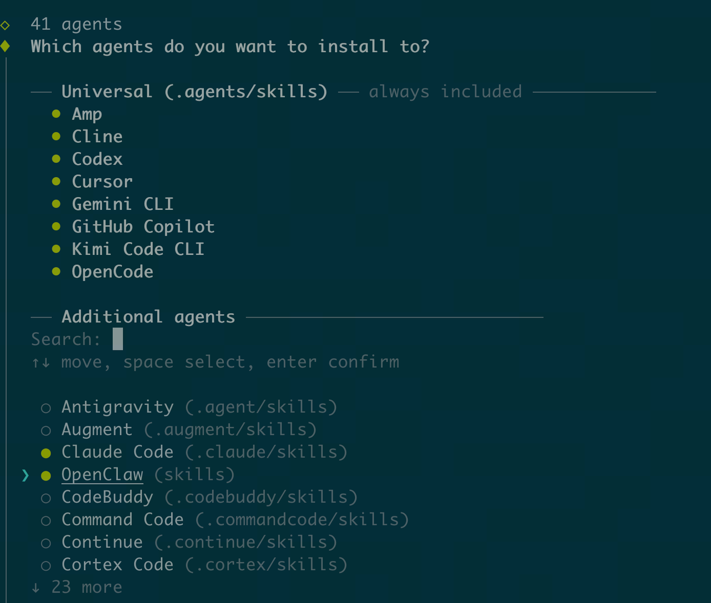
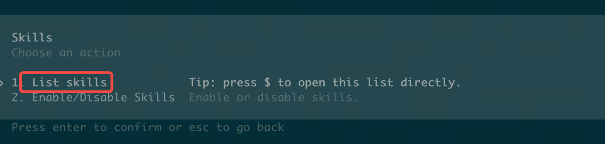
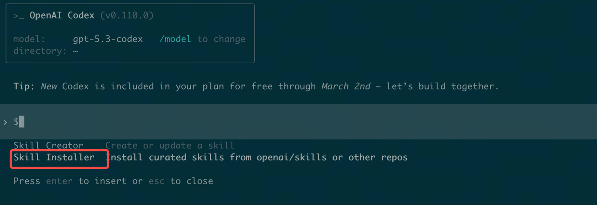
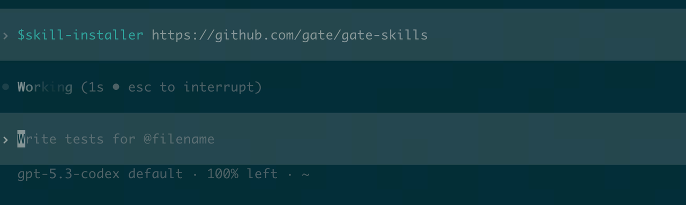
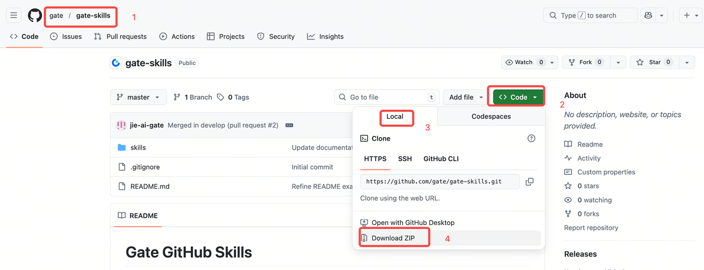
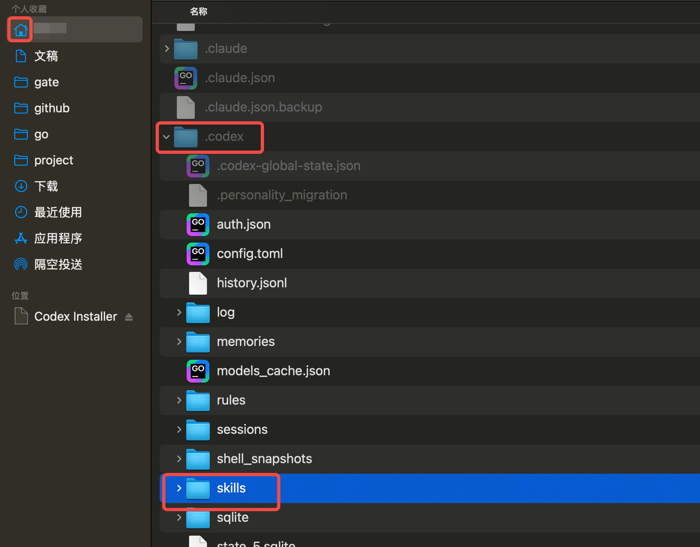

# Gate Skills

[English](README.md) | [中文](README_zh.md)

Gate Skills 是一个开放的技能市场，让 AI Agent 能够原生接入 Gate 的加密生态。从市场分析、衍生品监控到一键 MCP 配置，全部可通过自然语言完成。

由 Gate 构建，为加密社区而生。

## Gate CEX Skill 2.0

新版分为交易、理财、资产与充提、子账号、返佣、策略机器人六个 CLI Skill。Alpha 已纳入交易；六包在已批准编写范围内描述 379 个唯一归属命令路径（交易 282、理财 32、资产 29、子账号 12、返佣 12、机器人 12）；交易另复用资产的一项只读命令，不重复计数。对外使用 [Gate CLI 官方项目](https://github.com/gate/gate-cli)，运行前核实所需命令、参数与认证方式；文档覆盖不代表公开版本已支持。Pay 独立于 CEX，`gate-exchange-pay`、`gate-pay-x402` 及全部 DEX Skill 保留。

私有读取和所有写操作使用 Gate CLI。交易另有已批准的有界公共 [GET 兼容读取](skills/gate-cex-trade/references/markets.md)与 [WS helper](skills/gate-cex-trade/references/streams.md)；例外不允许私有 HTTP、MCP fallback、任意端点或切换环境。

安装前先生成独立包，公共文件会一起打包。使用已激活的 Python 3.11+ 虚拟环境，在仓库根目录执行：

```bash
# 在该环境安装固定的编写与检查依赖。
python -m pip install -r scripts/requirements-cex.txt
# 离线回归会构建和检查包，不调用业务 API。
python -B -m unittest discover -s tests/cex -p 'test_*.py'
# 输出目录必须是新目录，已有输出不会被覆盖。
python scripts/cex_skills.py build --source . --contract tests/cex/cli-contract.json --output dist/gate-cex-2.0
# 检查单个独立包。
python scripts/cex_skills.py check --target dist/gate-cex-2.0/gate-cex-trade --package --contract tests/cex/cli-contract.json
```

将生成的完整 Skill 目录复制到宿主的 Skill 目录，只安装所需包；不要直接复制依赖兄弟共享目录的 CEX 源码。[gate-cex-skill-audit](gate-cex-skill-audit/SKILL.md) 是顶层开发审核工具，不放在 `skills/`，也不进入六个业务包。确定性检查不代替业务语义及资金安全审查。

### 按产品安装

| 产品 | 所需安装 |
|------|----------|
| 六个 CEX Skill | 先安装 [Gate CLI](skills/gate-cli-installer/SKILL.md)，再按上方构建说明复制所需的独立安装包。 |
| 旧 Gate Pay | 保留 [gate-mcp-installer](skills/gate-mcp-installer/SKILL.md) 的 Exchange 连接安装模式，认证按支付 Skill 的要求处理。 |
| Gate Pay x402 | 按 [安装器说明](skills/gate-mcp-installer/README.md) 选择 gatepay-local 和可选商户发现，再按 [gate-pay-x402](skills/gate-pay-x402/SKILL.md) 配置钱包与支付授权；这两个 MCP 默认不安装。 |
| DEX / Info / News | 按所选产品的 CLI 或 MCP 前置条件安装；MCP 安装器保留 Pay 所需的 Exchange 模式，复制源码时排除 CEX 业务 Skill 目录。 |

先选择产品及所需 Skill。CLI 安装器负责 CLI 二进制，不安装 MCP 服务；没有另行卸载要求时保留用户已有安装。

### 框架兼容性

宿主需要能够加载所选 SKILL.md 及其引用，提供声明的 CLI/MCP 工具，并执行相应权限约束。具体安装及重载方式以宿主为准。

---

## Skills 总览

下表版本来自各 Skill 元数据，不代表 CLI 发行版本或线上服务可用性。Info/News 优先选择 CLI 主入口；兼容入口继续按自己的前置条件与 fallback 规则使用。

| Skill | 描述 | 版本 | 入口 / 安装方式 |
|-------|------|------|----------------|
| [gate-cex-trade](skills/gate-cex-trade/SKILL.md) | 交易与行情、账户交易设置 | `0.1.2` | 新版独立包 |
| [gate-cex-earn](skills/gate-cex-earn/SKILL.md) | 理财与独立抵押借贷 | — | 新版独立包 |
| [gate-cex-assets](skills/gate-cex-assets/SKILL.md) | 资产、划转与充值提现 | — | 新版独立包 |
| [gate-cex-subaccount](skills/gate-cex-subaccount/SKILL.md) | 子账号与 API Key 管理 | — | 新版独立包 |
| [gate-cex-affiliate](skills/gate-cex-affiliate/SKILL.md) | 关系、返佣与统计 | — | 新版独立包 |
| [gate-cex-bot](skills/gate-cex-bot/SKILL.md) | 网格、马丁与组合策略机器人 | — | 新版独立包 |
| [gate-info-coinanalysis](#-gate-info-coinanalysis) | 单币种综合分析：基本面、技术面、新闻、社交情绪 | `2026.4.6-1` | 兼容入口 |
| [gate-info-addresstracker](#-gate-info-addresstracker) | 链上地址追踪：地址画像、交易历史、资金流向分析 | `2026.4.3-1` | 兼容入口 |
| [gate-info-coincompare](#-gate-info-coincompare) | 多币种对比：多维度对比表与总结 | `2026.4.6-1` | 兼容入口 |
| [gate-info-defianalysis](#-gate-info-defianalysis) | DeFi 生态：TVL 排行、协议指标、收益/稳定币、跨链桥、交易所储备、爆仓热力图等（Gate-Info；只读） | `2026.4.7-1` | 兼容入口 |
| [gate-info-macroimpact](#-gate-info-macroimpact) | 宏观与加密联动：经济日历、指标、相关新闻与行情快照（Gate-Info + Gate-News；只读） | `2026.4.6-1` | 兼容入口 |
| [gate-info-marketoverview](#-gate-info-marketoverview) | 加密市场总览：板块排行、DeFi、事件、宏观摘要 | `2026.4.6-1` | 兼容入口 |
| [gate-info-riskcheck](#-gate-info-riskcheck) | 代币与合约风险评估：蜜罐检测、Rug Pull、税费、持币集中度 | `2026.4.3-1` | 兼容入口 |
| [gate-info-tokenonchain](#-gate-info-tokenonchain) | 代币链上：持币分布、活跃度、大额划转（本版不含 Smart Money；Gate-Info；只读） | `2026.4.7-1` | 兼容入口 |
| [gate-info-trendanalysis](#-gate-info-trendanalysis) | 趋势与技术分析：K线、RSI、MACD、多周期信号 | `2026.4.3-1` | 兼容入口 |
| [gate-news-briefing](#-gate-news-briefing) | 加密新闻简报：重大事件、热门新闻、社交情绪 | `2026.4.7-1` | 兼容入口 |
| [gate-news-communityscan](#-gate-news-communityscan) | 社区 / X 情绪：讨论扫描 + 量化社交情绪（多平台 UGC 上线后扩展；Gate-News；只读） | `2026.4.7-1` | 兼容入口 |
| [gate-news-eventexplain](#-gate-news-eventexplain) | 事件归因与解释：价格异动原因追溯与影响链分析 | `2026.4.3-1` | 兼容入口 |
| [gate-news-listing](#-gate-news-listing) | 交易所上架/下架追踪：公告监控与新币基本面补充 | `2026.4.6-1` | 兼容入口 |
| [gate-dex-market](#-gate-dex-market) | Gate DEX 行情数据（OpenAPI 模式）：代币信息、K线、排行、安全审计 | `2026.4.8-1` | ✅ Active |
| [gate-dex-trade](#-gate-dex-trade) | Gate DEX 交易：MCP + OpenAPI 双模式，智能路由执行 Swap | `2026.5.6-1` | ✅ Active |
| [gate-exchange-pay](#-gate-exchange-pay) | Gate Pay 支付执行：完成商户支付、支付优先流程、输出收据 | — | ✅ Active |
| [gate-mcp-installer](#-gate-mcp-installer) | 全平台一键安装 Gate MCP 与 Skills（Cursor、Claude Code、Codex、OpenClaw） | `2026.11.2-1` | ✅ Active |
| [gate-dex-wallet](#-gate-dex-wallet) | Gate DEX 综合钱包：身份认证、资产查询、转账执行、DApp 交互 | `2026.5.6-1` | ✅ Active |
| [gate-info-liveroomlocation](#-gate-info-liveroomlocation) | Gate 直播与回放列表：按分类、币种、热度/最新排序筛选 | `2026.4.8-1` | ✅ Active |
| [gate-info-research](#-gate-info-research) | CLI 优先的市场研究与 playbook 路由 | `2026.6.22-1` | CLI 主入口 |
| [gate-cli-installer](skills/gate-cli-installer/SKILL.md) | 安装 Gate CLI 二进制 | `2026.11.2-1` | CLI 安装器 |
| [gate-dex-market-cli](skills/gate-dex-market-cli/SKILL.md) | 通过 gate-dex 查询 DEX 行情和代币 | `2026.5.7-1` | CLI 使用 |
| [gate-dex-trade-cli](skills/gate-dex-trade-cli/SKILL.md) | 通过 gate-dex 执行 DEX Swap | `2026.5.7-1` | CLI 使用 |
| [gate-dex-wallet-cli](skills/gate-dex-wallet-cli/SKILL.md) | 通过 gate-dex 管理钱包、转账与签名 | `2026.5.7-1` | CLI 使用 |
| [gate-info-risk](skills/gate-info-risk/SKILL.md) | CLI 优先的代币、地址与项目风险检查 | `2026.6.12-5` | CLI 主入口 |
| [gate-info-web3](skills/gate-info-web3/SKILL.md) | CLI 优先的链上与 Web3 查询 | `2026.6.22-1` | CLI 主入口 |
| [gate-news-intel](skills/gate-news-intel/SKILL.md) | CLI 优先的新闻、事件与情绪查询 | `2026.6.22-1` | CLI 主入口 |
| [gate-pay-x402](skills/gate-pay-x402/SKILL.md) | HTTP 402 支付、钱包配置与商户发现 | `2026.11.3-2` | Pay 可选安装 |

---

## 🎬 gate-info-liveroomlocation

> **路径**: `skills/gate-info-liveroomlocation/`

Gate 直播与回放列表。按业务分类（行情分析、热点话题、区块链、其他）、币种、排序方式（最热/最新）和数量进行筛选。

**示例提示词**：
- `最热的直播间`
- `找 5 个 SOL 相关的直播`
- `最新的行情分析回放`
- `有 BTC 相关的直播吗？`

---

## 📊 gate-dex-market

> **路径**: `skills/gate-dex-market/`

Gate DEX 行情数据 Skill，使用 OpenAPI 模式通过 AK/SK 认证直接调用 API。提供代币信息、K线数据、排行榜、安全审计等只读查询。

**示例提示词**：
- `查询 BTC 代币信息`
- `显示 ETH 的 K 线数据`
- `最近有什么热门代币？`
- `检查这个代币的安全审计`

---

## 🔄 gate-dex-trade

> **路径**: `skills/gate-dex-trade/`

Gate DEX 交易综合 Skill，支持 MCP + OpenAPI 双模式。智能路由根据环境自动选择最优交易方式，支持跨链与单链 Swap 执行。

**示例提示词**：
- `用 100 USDT 兑换 ETH`
- `把 BNB 换成 PEPE`
- `获取 SOL 换 USDC 的报价`
- `使用 OpenAPI 模式买入代币`

---

## 💼 gate-dex-wallet

> **路径**: `skills/gate-dex-wallet/`

Gate DEX 综合钱包 Skill。统一入口，支持身份认证、资产查询、转账执行、DApp 交互四大模块，根据用户意图路由到具体子模块。

**示例提示词**：
- `登录我的钱包`
- `查看钱包余额`
- `转账 0.1 ETH 到 0x...`
- `将钱包连接到 Uniswap`
- `签名这条消息`

---

## 🔍 gate-info-addresstracker

> **路径**: `skills/gate-info-addresstracker/`

链上地址追踪与分析。提供地址画像、交易历史与资金流向追踪，支持基础查询和深度追踪两种模式，覆盖多链地址。

**示例提示词**：
- `追踪这个地址 0x...`
- `这个地址的持有者是谁？`
- `查看 bc1... 的资金流向`
- `检查地址活动`

---

## 📊 gate-info-coinanalysis

> **路径**: `skills/gate-info-coinanalysis/`

单币种综合分析。并行获取基本面、行情、技术面、新闻和社交情绪数据，由 LLM 汇总为结构化分析报告。

**示例提示词**：
- `分析一下 ETH`
- `SOL 现在怎么样？`
- `BTC 现在值得买吗？`
- `帮我全面分析 DOGE`

---

## ⚖️ gate-info-coincompare

> **路径**: `skills/gate-info-coincompare/`

多币种对比（2–5 个币种）。并行获取各币种行情快照和基本面数据，生成多维度对比表与总结。

**示例提示词**：
- `对比 BTC 和 ETH`
- `SOL 和 AVAX 哪个更好？`
- `对比 BTC、ETH、SOL 和 BNB`
- `DOGE 和 SHIB 有什么区别？`

---

## 🌐 gate-info-marketoverview

> **路径**: `skills/gate-info-marketoverview/`

加密市场总览。并行获取全市场数据、板块排行、DeFi 概览、近期事件和宏观摘要，生成市场简报式报告。

**示例提示词**：
- `今天市场怎么样？`
- `给我一个市场概览`
- `加密市场最近发生了什么？`
- `展示整体市场状况`

---

## 🛡️ gate-info-riskcheck

> **路径**: `skills/gate-info-riskcheck/`

代币与合约风险评估。执行 30+ 项风险检查，包括蜜罐检测、税费分析、持币集中度和名称风险等，生成结构化风险报告。

**示例提示词**：
- `这个代币安全吗？0x...`
- `检查 PEPE 的合约风险`
- `这是蜜罐吗？`
- `这个会不会是 Rug Pull？`

---

## 📉 gate-info-trendanalysis

> **路径**: `skills/gate-info-trendanalysis/`

趋势与技术分析。并行获取 K 线数据、指标历史、多周期信号和行情快照，生成多维度技术分析报告。

**示例提示词**：
- `BTC 技术分析`
- `看一下 ETH 的 RSI 和 MACD`
- `SOL 的趋势如何？`
- `查看 BNB 的支撑和阻力位`

---

## 🏗️ gate-info-defianalysis

> **路径**: `skills/gate-info-defianalysis/`

DeFi 生态分析（Gate-Info MCP）。按意图路由到总览、单协议深挖、收益池、稳定币、跨链桥、交易所链上储备或爆仓热力图等子场景；部分场景支持「先列表后细化」。只读。

**示例提示词**：
- `DeFi 总览和 TVL 前十协议`
- `Uniswap TVL 和成交量`
- `Aave 上 USDC 借贷收益`
- `币安 BTC 储备`
- `BTC 爆仓热力图`

---

## 🗓️ gate-info-macroimpact

> **路径**: `skills/gate-info-macroimpact/`

宏观与加密联动分析（Gate-Info + Gate-News MCP）：并行获取经济日历、宏观指标或摘要、相关新闻、关联币种行情快照。只读。

**示例提示词**：
- `CPI 对 BTC 有什么影响`
- `今天有没有重要宏观数据`
- `美联储决议对加密市场的影响`
- `最新非农和风险资产`

---

## ⛓️ gate-info-tokenonchain

> **路径**: `skills/gate-info-tokenonchain/`

代币级链上分析（Gate-Info MCP）：持币分布、链上活跃度、大额划转等。本版 **不包含** Smart Money / `smart_money` 维度，仅用 holders、activity、transfers。只读。

**示例提示词**：
- `ETH 持币分布`
- `SOL 链上活跃度`
- `BTC 大额转账`
- `ARB 链上综合情况`

---

## 📰 gate-news-briefing

> **路径**: `skills/gate-news-briefing/`

加密新闻简报。并行获取重大事件、热门新闻和社交情绪，生成分层新闻简报。

**示例提示词**：
- `最近加密圈发生了什么？`
- `今天的加密货币头条`
- `市场有什么新动态？`
- `给我最新的加密新闻`

---

## 🗣️ gate-news-communityscan

> **路径**: `skills/gate-news-communityscan/`

社区与社交情绪（Gate-News MCP），当前以 **X/Twitter** 为主：X 讨论检索与量化社交情绪并行。多平台 UGC 未上线时须标明 **仅 X/Crypto Twitter**。只读。

**示例提示词**：
- `大家怎么看 ETH`
- `比特币推特情绪`
- `社区对 ETF 怎么说`
- `今天 SOL 上的 KOL 观点`

---

## 💡 gate-news-eventexplain

> **路径**: `skills/gate-news-eventexplain/`

事件归因与解释。当用户询问价格异动原因时，多步调用追溯事件来源，结合行情和链上数据，输出「事件 → 影响链 → 市场反应」分析报告。

**示例提示词**：
- `BTC 为什么暴跌？`
- `ETH 刚才怎么了？`
- `SOL 为什么在涨？`
- `DOGE 暴跌的原因是什么？`

---

## 📋 gate-news-listing

> **路径**: `skills/gate-news-listing/`

交易所上架/下架追踪。获取交易所上新、下架和维护公告，为高关注度新币补充基本面和行情数据。

**示例提示词**：
- `最近有什么新币上架？`
- `币安这周上了什么币？`
- `查看最近的下架公告`
- `今天有新代币上线吗？`

---

## 🛠️ gate-mcp-installer

> **路径**: `skills/gate-mcp-installer/`

全平台统一安装器，支持 Cursor、Claude Code、Codex 和 OpenClaw/mcporter，安装所选 Gate MCP 与非 CEX Skill；CEX 使用上方独立包流程。

**快速开始**：
```bash
# 在仓库根目录执行
bash skills/gate-mcp-installer/scripts/install.sh
```

可选：`--no-skills` 仅安装 MCP；`--mcp main --mcp dex` 等只安装指定 MCP。

---

## 🔬 gate-info-research

> **路径**: `skills/gate-info-research/`

CLI 优先的市场研究入口，覆盖市场简报、单币研究、多币对比、趋势与宏观背景；风险、链上及新闻优先的问题转向对应主入口，fallback 按本 Skill 的契约处理。

**示例提示词**：
- `帮我做一份市场研究简报`
- `对比 BTC 和 ETH 基本面与风险`
- `为什么 SOL 今天大涨？`
- `今日加密市场概览`

---

## 💳 gate-exchange-pay

> **路径**: `skills/gate-exchange-pay/`

Gate Pay 支付执行 Skill。完成商户支付、满足支付优先流程（如 HTTP 402）并输出收据。需先完成 Gate 支付授权。

**示例提示词**：
- `用 Gate Pay 支付`
- `完成这笔订单的支付`
- `帮我支付这个订单`

---

## 快速开始

### 前置要求

- 支持 skill 加载的 AI Agent 环境（例如 Cursor、OpenClaw）
- 六个 CEX Skill 需要 Gate CLI 及按上文生成的独立安装包
- 仅使用 Node 安装器或相关 MCP 服务的产品需要 Node.js 与 npm

### 配置步骤

CEX 按上方 Gate CLI 与独立安装包说明安装。Pay 或其他依赖 MCP 的产品使用 `gate-mcp-installer`，自动检测 Cursor、Claude Code、Codex 或 OpenClaw：

```bash
# 在仓库根目录执行
bash skills/gate-mcp-installer/scripts/install.sh
```

或直接向 AI 助手说：
```
帮我安装 Gate MCP
```

仅安装 MCP：`bash skills/gate-mcp-installer/scripts/install.sh --no-skills`

加载 `gate-pay-x402` 后，显式选择它的可选支付与商户发现服务；公开 HTTPS
商户目录地址见安装器 README：

```bash
# 仅为 Cursor 配置两个 x402 服务，不复制源码 Skill。
bash skills/gate-mcp-installer/scripts/install.sh --platform cursor --mcp gatepay-local --mcp gatepay-discovery --no-skills
```

钱包在本地按 [gate-pay-x402](skills/gate-pay-x402/SKILL.md) 配置。
六个 CEX Skill 使用自己的 CLI 安装及认证规则。

### 开始使用 Skills

安装完成后，向 AI Agent 提出任意市场或交易问题即可。

---

## Skills 安装说明

核对所选目录的实际 `SKILL.md` 名称与加载结果，不以历史截图或固定数量作为安装成功依据。CEX 安装使用生成的独立包。

### 通用安装（非 CEX）

以下源码复制和市场安装示例适用于非 CEX Skill。CEX 使用上文生成的独立包，直接复制全部源码目录不能得到可独立使用的 CEX 包。

1. 检查是否已安装 `npx`（未安装见附录）：

   ```bash
   npx -v
   ```

   若返回版本号（例如 `11.8.0`），说明 `npx` 已安装。

2. 通过交互方式安装 skills：

   ```bash
   npx skills add https://github.com/gate/gate-skills
   ```

3. 安装指定 skill（示例：`gate-info-coinanalysis`）：

   ```bash
   npx skills add https://github.com/gate/gate-skills --skill gate-info-coinanalysis
   ```



### 在 Claude CLI 中安装 Skills

#### 方式一：自然语言安装（推荐）

```text
help me to install skills, github url is: https://github.com/gate/gate-skills
```

确认所选 Skill 已按实际名称加载。

#### 方式二：手动安装

Step 1：下载 Skills 包（GitHub：<https://github.com/gate/gate-skills>）

Step 2：解压后复制到 `~/.claude/skills/` 目录。

- 显示隐藏目录：打开用户主目录后按 `Command + Shift + .`（再次按下可隐藏）
- 复制到目标路径：将 `gate-skills-master` 中所需的非 CEX `skills` 子目录复制到 `~/.claude/skills/`
- 验证安装：在 Claude CLI 输入 `/skills`，并核对所选名称

### 在 Codex CLI 中安装 Skills

#### 方式一：自然语言安装（推荐）

```text
help me to install skills, github url is: https://github.com/gate/gate-skills
```

重启 Codex 后生效。

#### 方式二：终端安装

1. 在终端输入 `/skills`，选择 `1. List skills`，再选择 `Skill Installer`，输入 `https://github.com/gate/gate-skills`

   
   
   

2. 验证安装：重启终端后执行 `/skills` -> `List Skills`

#### 方式三：手动安装

Step 1：下载 Skills 包（GitHub：<https://github.com/gate/gate-skills>）



Step 2：解压后复制到 `~/.codex/skills/` 目录。

1. 显示隐藏目录：打开用户主目录后按 `Command + Shift + .`（再次按下可隐藏）

   

2. 复制到目标路径：将 `gate-skills-master` 中所需的非 CEX `skills` 子目录复制到 `~/.codex/skills/`

3. 验证安装：重启终端后执行 `/skills` -> `List Skills`

### 在 OpenClaw 中安装 Skills

#### 方式一：对话安装（推荐）

在 OpenClaw 聊天界面（如 Telegram、飞书）直接发送 GitHub 链接给助手，例如：

```text
帮我安装这个技能：https://github.com/gate/gate-skills
```

助手会自动拉取仓库、配置环境并尝试加载该 skill。

#### 方式二：使用 ClawHub 自动安装（推荐）

- 官方市场（需先安装 `npx`，见附录）：

  ```bash
  npx clawhub@latest install gate-skills
  ```

- GitHub 仓库：

  ```bash
  npx clawhub@latest add https://github.com/gate/gate-skills
  ```

#### 方式三：手动安装

Step 1：下载 Skills 包（GitHub：<https://github.com/gate/gate-skills>）


Step 2：解压后复制到 `~/.openclaw/skills/` 目录。

1. 显示隐藏目录：打开用户主目录后按 `Command + Shift + .`（再次按下可隐藏）
2. 复制到目标路径：将 `gate-skills-master` 中所需的非 CEX `skills` 子目录复制到 `~/.openclaw/skills/`

Step 3：重启 OpenClaw Gateway。

### 附录：macOS 安装 npx

1. 检查是否已安装 `npx`：

   ```bash
   npx -v
   ```

   若返回版本号（例如 `11.8.0`），说明 `npx` 已安装。

2. 若未安装，可使用以下方式：

   - 方式一：通过 Homebrew 安装

     ```bash
     # 安装 Homebrew（官方）
     /bin/bash -c "$(curl -fsSL https://raw.githubusercontent.com/Homebrew/install/HEAD/install.sh)"

     # 安装 Homebrew（国内镜像）
     /bin/zsh -c "$(curl -fsSL https://gitee.com/cunkai/HomebrewCN/raw/master/Homebrew.sh)"

     # 验证 Homebrew
     brew --version

     # 安装 Node.js（包含 npx）
     brew install node

     # 验证 npx
     npx -v
     ```

   - 方式二：从 Node.js 官网下载安装包：
     <https://nodejs.org/en/download>

---

## 仓库结构

```
gate-github-skills/
├── README.md
├── README_zh.md
├── gate-cex-skill-audit/                # 开发审核 Skill，不进入业务包
├── image/                              # 安装截图
├── scripts/                            # 打包与契约检查工具
├── tests/                              # 离线回归测试
├── docs/                               # 使用指南与审查记录
└── skills/
    ├── gate-cex-trade/
    ├── gate-cex-earn/
    ├── gate-cex-assets/
    ├── gate-cex-subaccount/
    ├── gate-cex-affiliate/
    ├── gate-cex-bot/
    ├── gate-pay-x402/
    ├── gate-news-intel/
    ├── gate-info-web3/
    ├── gate-info-risk/
    ├── gate-dex-wallet-cli/
    ├── gate-dex-trade-cli/
    ├── gate-dex-market-cli/
    ├── gate-cli-installer/
    ├── gate-exchange-pay/             # Gate Pay 独立支付 Skill（不属于 CEX）
    ├── _shared/cex/                    # CEX 公共源码，构建时随各包分发
    ├── gate-dex-market/                # DEX 行情数据 skill（OpenAPI 模式）
    ├── gate-dex-trade/                 # DEX 交易 skill（MCP + OpenAPI 双模式）
    ├── gate-dex-wallet/                # DEX 综合钱包 skill
    ├── gate-info-addresstracker/       # 链上地址追踪 skill
    ├── gate-info-coinanalysis/         # 单币种分析 skill
    ├── gate-info-coincompare/          # 多币种对比 skill
    ├── gate-info-defianalysis/         # DeFi TVL、协议、收益、桥、储备、爆仓 skill
    ├── gate-info-liveroomlocation/     # 直播与回放列表 skill
    ├── gate-info-macroimpact/          # 宏观日历、指标、新闻与行情联动 skill
    ├── gate-info-marketoverview/       # 市场总览 skill
    ├── gate-info-riskcheck/            # 代币风险评估 skill
    ├── gate-info-tokenonchain/         # 代币链上持币、活跃度、大额划转 skill
    ├── gate-info-trendanalysis/        # 趋势与技术分析 skill
    ├── gate-news-briefing/             # 新闻简报 skill
    ├── gate-news-communityscan/       # 社区 / X 情绪 skill
    ├── gate-news-eventexplain/         # 事件解释 skill
    ├── gate-news-listing/              # 上架/下架追踪 skill
    └── gate-mcp-installer/             # 全平台统一 MCP + Skills 安装 skill（Cursor、Claude Code、Codex、OpenClaw）
```

---

## 关于本仓库

业务及安装 Skill 位于 `skills/` 下；开发审核工具 `gate-cex-skill-audit/` 位于仓库根目录，不进入业务包。各 Skill 按需要包含：

- **`SKILL.md`** — Skill 定义（YAML 必需字段为 name/description，其余元数据按产品选择）及结构化说明（路由规则、工作流等）
- **`references/`** — 按需要提供的产品参考、工作流与模板
- **`CHANGELOG.md`** — 可选的真实接口及参数变更记录

---

## 贡献指南

产品编写规则见[开发指南](docs/skill-development-guide.md)，正式离线回归命令见
[测试指南](tests/README.md)，CEX 内容审查使用
[gate-cex-skill-audit](gate-cex-skill-audit/SKILL.md)。对外说明与截图不得携带
个人检出路径、内部仓库/服务位置或私人凭据值。

欢迎贡献！新增 skill 的流程如下：

1. **Fork 仓库**并创建新分支：
   ```bash
   git checkout -b feature/<skill-name>
   ```

2. 在 `skills/` 下创建新目录，至少包含一个 `SKILL.md` 文件。

3. 按要求格式编写：
   ```markdown
   ---
   name: <skill-name>
   description: A clear description of what the skill does and when to trigger it.
   ---

   # <Skill Title>

   [Add instructions, routing rules, workflows, and report templates here]
   ```

   版本、兼容性及宿主元数据按所选产品需要添加；必需字段及文件约定以对应产品契约为准。

4. 对复杂子模块，在 `references/` 子目录中补充参考文档。

5. 向 `master` 分支发起 Pull Request。

---

## 免责声明

Gate Skills 仅为信息工具。所有输出均按"现状"和"可用"基础提供，不构成任何明示或暗示的保证。其内容不构成投资、金融、交易或任何其他形式的建议，也不构成买入、卖出或持有任何资产的推荐。数字资产价格具有高风险和高波动性。你需要对自己的投资决策负责。历史表现不代表未来结果。进行任何投资前，请咨询独立的专业财务顾问。
